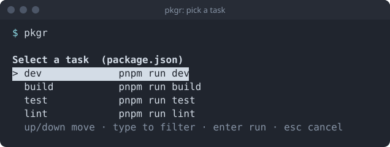

This takes about a minute once pkgr is [installed](../install/).

## 1. Go to a project

Any directory with a `package.json` (with a `scripts` section), a `deno.json` or a `deno.jsonc` (with `tasks`):

```bash
cd my-project
```

## 2. Run pkgr

```bash
pkgr
```



The title tells you which manifest it read. Each row is a task name and the command behind it.

## 3. Choose

- <kbd>↑</kbd> / <kbd>↓</kbd> move the highlight.
- Type to narrow the list.
- <kbd>Enter</kbd> runs the highlighted task.
- <kbd>Esc</kbd> cancels and runs nothing.

When you press <kbd>Enter</kbd>, pkgr prints the exact command it is about to run, then runs it in the foreground:

```text
> pnpm run dev
```

That line is copyable, so you can learn the real command and skip the picker next time.

## What next

- [Choosing a project](../../guides/choosing-a-project/) to point pkgr at another folder.
- [How pkgr picks the package manager](../../guides/package-managers/).
- [Keyboard reference](../../guides/keyboard/).
- [Troubleshooting](../../guides/troubleshooting/) if something looks wrong.
