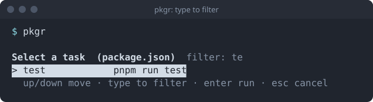

| Key | Action |
| --- | --- |
| <kbd>↑</kbd> / <kbd>↓</kbd> | Move the highlight. It stops at the first and last row. |
| <kbd>Home</kbd> / <kbd>End</kbd> | Jump to the first or last row. |
| <kbd>Page Up</kbd> / <kbd>Page Down</kbd> | Same as <kbd>Home</kbd> and <kbd>End</kbd>. |
| any character | Add it to the filter. |
| <kbd>Backspace</kbd> | Remove the last filter character. |
| <kbd>Enter</kbd> | Run the highlighted task. |
| <kbd>Esc</kbd> | Cancel. Nothing runs. Exit code 130. |
| <kbd>Ctrl</kbd>+<kbd>C</kbd> | Same as <kbd>Esc</kbd> while the picker is open. |

Anything else, such as mouse reports or bracketed-paste markers, is swallowed whole and does not end up in the filter.

## Filtering

The filter is a **case-insensitive substring match** over both the task name and its command. Typing `te` matches `test` by name and anything whose command contains `te`.

The title line shows the active filter. If nothing matches, the list says so and <kbd>Enter</kbd> does nothing.

Case is folded for ASCII only. `étape` will not find `ÉTAPE`, though `ÉTAPE` does find `étape`. This is a deliberate size trade, covered in [Size](../../reference/size/).

## Long lists

When there are more tasks than rows that fit the screen, the list scrolls and shows `... N more` beneath it. The highlight index always refers to the filtered view, and pkgr maps it back to the original task when you press <kbd>Enter</kbd>, so the right script runs.

## While a task runs

After you press <kbd>Enter</kbd> the picker is gone and the terminal is returned exactly as it was. From then on <kbd>Ctrl</kbd>+<kbd>C</kbd> goes to the task, not to pkgr.
