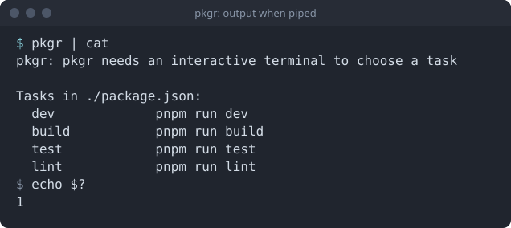

pkgr is an interactive tool. Without a terminal there is nothing to pick from, so it does the next most useful thing.

## Redirected input or output

If stdin or stdout is not a terminal (a pipe, a file, a CI runner), pkgr prints what is available and exits with code 1:



The output goes to stderr and shows the command that each task would run. It is a quick way to see what a project offers.

## Not for CI

In automation, call your package manager directly (`pnpm run build`). pkgr exists to save typing and memory at a human keyboard, not to replace a build script.

## Exit codes

| Code | Meaning |
| --- | --- |
| the task's own code | the task ran; pkgr passes its exit code through |
| `0` | `-version` or `-h` |
| `1` | usage error, unreadable or invalid manifest, no terminal, or the task could not be started |
| `130` | you cancelled at the picker |

Because pkgr returns the task's own code, you can chain it:

```bash
pkgr && echo "task succeeded"
```
