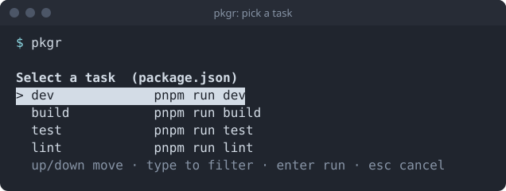
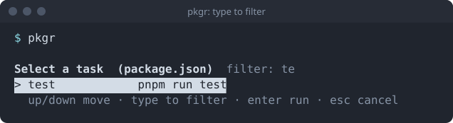
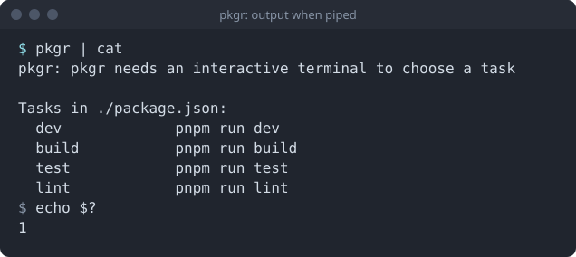

## Run it

```bash
pkgr
```



Arrow keys move, <kbd>Enter</kbd> runs, <kbd>Esc</kbd> or <kbd>Ctrl</kbd>+<kbd>C</kbd> cancels without running anything.

## Filter

Just start typing. The filter is a case-insensitive substring match over the task name and its command.



## Choose a project

```text
pkgr [path]
```

| Invocation | Reads |
| --- | --- |
| `pkgr` or `pkgr .` | the manifest in the current directory |
| `pkgr ./packages/api` | the manifest in that directory |
| `pkgr ./packages/api/package.json` | that file |

For a directory, pkgr looks for `package.json`, then `deno.json`, then `deno.jsonc`. It does not search parent directories.

## Piped or redirected

With no terminal to draw on, pkgr prints the tasks and the command for each, then exits 1.



:::note
The screenshots on this page are renderings of pkgr's real output and picker frames, drawn as SVG so they stay a few hundred bytes each.
:::
