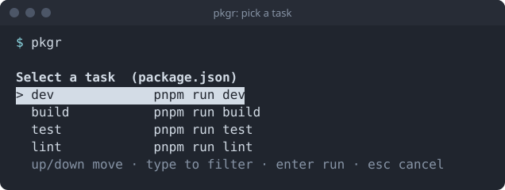

## What is pkgr?

Choosing `dev` runs `pnpm run dev` (or `npm`, `yarn`, `bun`, `deno task`, whichever the project uses) in that project's directory, attached to your terminal exactly as if you had typed it yourself.

- **Tiny.** One static binary, no runtime dependencies.
- **Honest.** Runs in the foreground, passes through colour and prompts, and exits with the task's own exit code.
- **Predictable.** Tasks are listed in file order, and nothing runs if you cancel.
- **Everywhere.** Linux, Windows and macOS (Apple silicon and Intel).

Part of the [Floppy Rule](https://malcomber.com/floppy-rule/): every byte has to earn its place.

## At a glance

| | |
|---|---|
| Size of the program | {{metric.size}} |
| Platforms | {{metric.platforms}} |
| Dependencies you need | {{metric.dependencies}} |
| Reads | `package.json`, `deno.json`, `deno.jsonc` |
| Current release | [v{{version}}](/releases/v{{version}}/) |

See [the size breakdown](/reference/size/) and [how it is built](/reference/architecture/).

## Where to next?

- New here? Read [about pkgr](/welcome/about/) and the [features](/welcome/features/).
- Ready to try it? Follow [Install](/getting-started/install/) and the [quick start](/getting-started/quick-start/).
- Using it daily? See [Using pkgr](/guides/using-pkgr/), the [keyboard](/guides/keyboard/) and [package managers](/guides/package-managers/).
- Scripting? Read the [command line reference](/reference/cli/) and [scripts and CI](/guides/scripts-and-ci/).
- Want to know what is coming? See the [roadmap](/roadmap/) and the [release notes](/releases/).

Support the project: [Buy Me a Coffee](https://buymeacoffee.com/rmalcomber) or [GitHub Sponsors](https://github.com/sponsors/rmalcomber).
