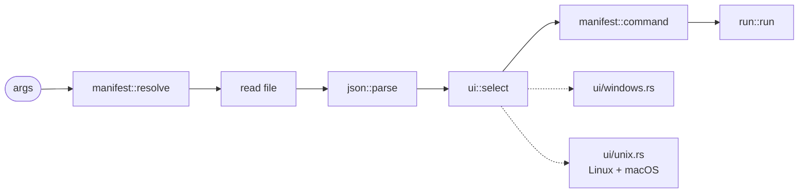

pkgr is about 1,400 lines of Rust and one third-party dependency per platform.

| Path | Purpose |
| --- | --- |
| `src/main.rs` | CLI, wiring, exit codes |
| `src/manifest.rs` | locating manifests, package-manager detection, building the command |
| `src/json.rs` | the JSONC scanner |
| `src/ui/` | the picker: `mod.rs` is the loop, `windows.rs` and `unix.rs` are the two terminals |
| `src/run.rs` | PATH resolution and foreground execution |

## Flow



1. `resolve` turns the argument into a manifest path and kind.
2. `json::parse` extracts tasks and `packageManager`.
3. `ui::select` draws the picker and returns an index into the original task list.
4. `command` produces the argv, `<tool> run <task>` or `deno task <task>`.
5. `run` finds the tool on `PATH` and runs it in the manifest's directory, inheriting stdio.

## The terminal seam

The picker loop is written against a small `Console` trait: width, write, clear, read a key. It knows nothing about the OS. Each platform supplies one `Terminal` type, chosen by `#[cfg]` at compile time, so a new port is a new file rather than a new branch in the loop.

- **Windows**: `GetConsoleMode` / `SetConsoleMode` to turn off line input, echo and processed input; `ReadConsoleInputW` for keys; VT sequences for drawing; a `Drop` that restores the console however the picker exits.
- **Unix**: `tcgetattr` / `tcsetattr` to clear `ICANON`, `ECHO` and `ISIG`; `TIOCGWINSZ` for width; an escape-sequence decoder; a 50 ms wait to tell a bare Esc from the start of a sequence.

## Dependencies

```text
pkgr
├── windows-sys   Win32 bindings (Windows targets only)
└── libc          libc bindings  (unix targets only)
```

Never both: each is declared under a target-specific key, so Cargo leaves the other out of the build graph entirely. Both are declarations rather than code.
