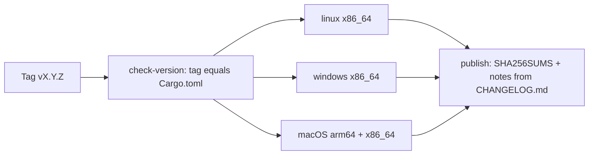

Releases are built by [GitHub Actions]({{repo}}/actions). Nothing needs to be installed locally beyond git.

## What a release produces

One run of the **Release** workflow (`.github/workflows/release.yml`) on a `vX.Y.Z` tag:

| Asset | Built on | Notes |
|---|---|---|
| `pkgr-linux-x86_64` | Linux runner | static musl, pinned nightly Rust with `panic=immediate-abort` |
| `pkgr-windows-x86_64.exe` | Windows runner | stable Rust |
| `pkgr-macos-arm64` | macOS (Apple silicon) runner | stable Rust; not signed or notarised |
| `pkgr-macos-x86_64` | macOS runner, cross-compiled | stable Rust; not signed or notarised |
| `SHA256SUMS` | | checksums of every file above |



Every job runs the same gates as an ordinary commit (`fmt`, `clippy -D warnings`, tests) before building. Release notes come from the matching `## X.Y.Z` section of `CHANGELOG.md`; the run fails if that section is missing. Tags containing a `-` are published as pre-releases.

## Cutting a release

1. Bump `version` in `Cargo.toml` and `Cargo.lock`, and `version` in `docs/src/site.config.mjs`.
2. Add a `## X.Y.Z - date` section to `CHANGELOG.md` (and mirror it in the docs [changelog](/project/changelog/)), plus a page in `docs/src/content/docs/releases/` and a row in its index. Give the new page the lowest `sidebar.order`.
3. Commit, then tag and push:

   ```bash
   git tag v0.0.2
   git push origin main v0.0.2
   ```

4. Watch **Actions → Release**.

## Trying it without publishing

Open **Actions → Release → Run workflow**. A manual run builds every platform and keeps the files as artifacts; it skips the version check and the publish job, so nothing is released.

## The documentation site

The **Docs** workflow (`.github/workflows/docs.yml`) builds this site and deploys it to GitHub Pages whenever `docs/` changes on `main`. Enable Pages once under **Settings → Pages → Source: GitHub Actions**.
